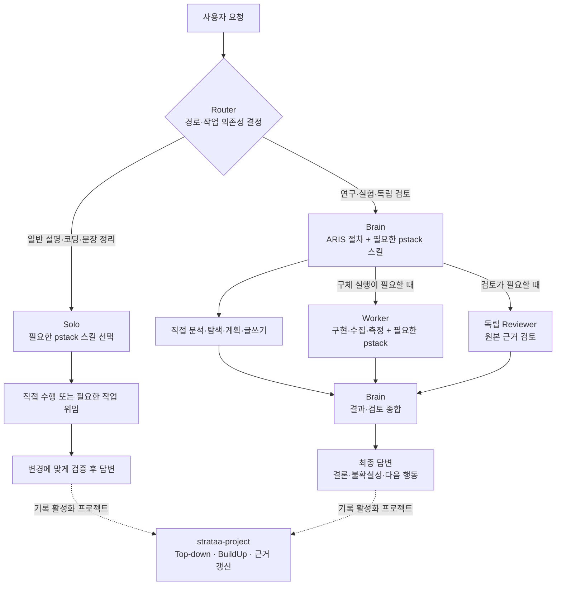

# Strataa

[English](README.md) · 한국어

Strataa는 OMP CLI에서 연구와 일반 작업을 구분하고, 필요한 스킬·모델·위임을 연결하는 플러그인입니다. 프로젝트 근거와 결정을 기록하고 공개 실행 결과를 Flow로 보여줍니다. Dashboard는 선택 사항이며 자동으로 실행하지 않습니다.

- 저장소: [myunhh/Strataa](https://github.com/myunhh/Strataa)
- 플러그인 ID: `omp-agent-strataa`, 명령: `/strataa`
- 연구 절차: [ARIS](https://github.com/wanshuiyin/auto-claude-code-research-in-sleep) 스킬 87개
- 작업 방식: [pstack](https://github.com/cursor/plugins/tree/bf0c7cd80abdbf7fe47b634978a7d1b4071f71a7/pstack) v0.15.42의 스킬 58개와 에이전트 2개

OMP·ARIS·pstack 공식 배포판과는 별개의 적용판입니다. OMP 본체, 공통 하네스, 인증, 전역 모델 기본값과 재귀 설정을 변경하지 않습니다.

## 설치

Node.js 22.13 이상과 OMP 18.20.3 이상이 필요합니다.

```sh
git clone https://github.com/myunhh/Strataa.git
cd Strataa
node install.mjs
```

설치기는 현재 호스트의 `~/.local/share/omp-agent-strataa/<version>-<fingerprint>/`에 독립 복사한 뒤 `omp plugin link`로 연결합니다. clone을 지워도 설치본은 유지되며, upstream 변경은 자동 반영하지 않습니다. 다른 호스트에서는 해당 호스트에서 설치를 실행해야 합니다.

진행 중인 OMP 작업을 마친 뒤 다음 명령을 실행합니다.

```text
/reload-plugins
/strataa skills
/strataa pstack
/strataa models
/strataa on
```

새 세션의 **Strataa 라우팅은 기본 OFF**입니다. ON 상태에서는 스킬 이름을 지정하지 않고 평소처럼 요청할 수 있습니다.

ADHD 친화 응답 스킬 `i-have-adhd`는 기본 탑재되며, 라우팅과 무관하게 **기본 ON**입니다. `/i-have-adhd off`, `stop adhd mode`, `normal mode`로 현재 세션에서 끄고 `/i-have-adhd on`으로 다시 켭니다. 저장된 세션 설정과 기존 `i-have-adhd.json`의 `alwaysOn: false`는 유지합니다. 별도 플러그인을 설치했다면 Strataa 설치 후 `omp plugin disable i-have-adhd@i-have-adhd`로 비활성화해 명령·훅 중복을 방지하세요.

원본은 Ayoub Ghriss의 [i-have-adhd v0.3.0](https://github.com/ayghri/i-have-adhd/tree/839872f9d1cd634fed642b4589ce7226199cc15f)이며 [MIT 라이선스](ADHD-LICENSE)를 포함합니다. 기본 플래그 ON과 명시적 `alwaysOn` 설정 우선순위만 변경하고, 스킬 규칙과 컨텍스트 호환 헬퍼는 원문을 유지합니다.

Dialogue에서 전환할 때는 새 설치가 성공한 뒤 `omp plugin uninstall omp-agent-dialogue`로 이전 등록만 제거합니다. 이전 설치본·연구 DB·세션 기록은 삭제하지 않습니다. 이전 명령 별칭은 제공하지 않으며 환경 변수는 `STRATAA_*`와 `OMP_STRATAA_FLOW_DIR`를 사용합니다. 기존 데이터 경로와 세션 직렬화 ID는 유지합니다.

## 실행 구조



[그림 미리보기](figures/workflow-ko.md) · [Mermaid 원본](figures/workflow-ko.mmd)

문장 정리에 리뷰를 강제하지 않습니다. 새 산출물의 검토는 생산 완료 후 진행합니다. 점선은 기록이 활성화된 프로젝트의 유지 작업이며, 실제 변경이 있을 때만 갱신합니다. 읽기 전용 요청에서는 기록도 수정하지 않습니다.

### 각 구성 요소의 책임

| 구성 요소 | 책임 |
| --- | --- |
| OMP | 모델·도구·세션·native `task` 실행과 호스트 권한을 제공합니다. |
| Strataa | Router, 역할별 모델 선택, 의존 단계 실행, 공개 결과 추적과 OMP 적용 계약을 연결합니다. |
| ARIS | 선택한 연구 스킬의 절차·산출물·검토 요구·종료 조건을 정합니다. |
| pstack | 설계·구현·디버깅·설명·글쓰기에서 필요한 작업 방식을 제공합니다. |

일반 작업은 Solo가 맡습니다. 연구·검토 작업은 메인 세션인 Brain이 계획과 판단, 최종 종합을 맡습니다. Brain은 직접 작업할 수 있고, 분리할 가치가 있는 실행만 Worker에 맡깁니다. Reviewer는 별도 읽기 전용 세션에서 원본 산출물과 중립 브리프를 읽습니다.

스킬은 에이전트가 읽고 따르는 지침입니다. 모든 문장을 런타임이 기계적으로 강제하는 것은 아닙니다. Strataa는 설치 무결성, 모델 선택, 단계 의존성, 위임 범위와 검토 완료 근거 등 구현된 경계를 검사합니다.

### 필요한 만큼만 pstack 적용

Solo뿐 아니라 Brain과 범위가 정해진 ARIS Worker도 pstack을 사용합니다. 공통 OMP 적용 계약과 역할별 지침을 전달하며, 전체 스킬을 매번 넣는 대신 필요한 원본과 하위 스킬을 읽습니다. Reviewer에는 작성자용 pstack 지침을 넣지 않습니다.

아이디어와 가설은 자유롭게 탐색하고 불확실성은 그대로 표시합니다. 문장 다듬기·번역·표현 정리만 요청하면 연구 문서라도 Solo가 처리하며 필수 리뷰나 패널을 만들지 않습니다. 명시적인 연구 검토나 실험 요청은 별도로 라우팅합니다.

주장의 의미가 바뀔 때는 관련 근거만 확인합니다. 예를 들어 상관관계를 인과관계로 고치거나, 미실행 실험을 완료 결과처럼 쓰거나, 수치·인용·수용 상태를 바꾸는 경우입니다. 모든 문장 수정을 새 연구 검토로 확대하지 않습니다.

실제 비용, 외부 공개, 배포, 유료 자원과 되돌리기 어려운 행동에는 기존 승인 경계를 유지합니다. 스킬 선택은 추가 승인이 아닙니다. 선택한 ARIS 스킬이 요구하는 독립 검토·라운드·예산·종료 조건도 유지하며, 필요한 검토를 생략하고 통과했다고 기록하지 않습니다.

## 요청과 명령

예를 들어 다음과 같이 요청합니다.

> ARIS experiment-plan으로 이 가설을 구분할 실험을 설계해 줘. 실제 실험은 실행하지 마.

> 이 연구 초안의 문장만 다듬어 줘. 주장·수치·인용의 의미는 바꾸지 마.

> ARIS research-review로 이 초안을 한 라운드 검토해 줘. 수용한 지적·반박·남은 이견을 구분해 줘.

| 명령 | 동작 |
| --- | --- |
| `/strataa on` | 설치와 실행 준비 상태를 확인하고 다음 입력부터 자동 라우팅합니다. |
| `/strataa off` | 다음 입력부터 자동 라우팅을 끕니다. 이미 시작한 실행과 현재 모델은 유지합니다. |
| `/strataa status` | 현재 모드·역할별 모델·설치 상태를 표시합니다. |
| `/strataa skills` | ARIS 스킬 87개, 원본 commit, 설치 경로와 실행 준비 상태를 표시합니다. |
| `/strataa pstack` | pstack 전체 목록·버전·원본 무결성을 확인합니다. |
| `/strataa models` | 전체 역할 일괄 설정, 역할별 선택, 기본 조합 복원을 엽니다. |
| `/strataa flow` | 현재 실행의 Wave·작업·공개 결과 상세 화면을 엽니다. |
| `/strataa watch` | 별도 터미널에서 같은 호스트의 여러 OMP 세션을 관찰합니다. |
| `/strataa stop` | 진행 중인 라우팅 또는 확장이 시작한 실행을 중단합니다. |

`/poteto-mode`, `/architect`, `/why` 등 개별 스킬도 직접 호출할 수 있습니다. OMP의 스킬 slash command를 직접 실행하는 경로는 Strataa 입력 라우팅을 거치지 않으므로, 자동으로 적용되는 ARIS 검토 변환 계약과 구분해야 합니다.

Router는 요청과 최근 대화를 봅니다. 실험·학습 실행은 `run-experiment`, 여러 seed·config와 의존 큐는 `experiment-queue`, 실행 관찰은 `monitor-experiment`를 선택합니다. 자율 검토·수정은 `auto-review-loop`, 전체 자율 연구는 `research-pipeline`에 해당합니다.

계획 요청을 실행 승인으로 바꾸지 않습니다. 파일명에 “실험”이나 “overnight”가 있다는 이유만으로 코드 수정을 실험 실행으로 취급하지 않습니다. 밤샘 요청도 무한 반복이나 새 유료 자원 임대 승인이 아닙니다. 실제 자원·권한·필수 입력을 확인하고 사용자의 시간·라운드·비용 한도를 따릅니다.

### PaperOrchestra와 집필을 나눌 때

기본 집필기는 바뀌지 않습니다. [PaperOrchestra](https://github.com/google-research/paper-orchestra)에 문헌 조사만 맡기거나, 이미 생성한 초안을 Strataa로 검토할 때 선택합니다. 라우팅을 켠 뒤 “이 PaperOrchestra 결과를 가져와서 다시 쓰지 말고, 원본 CSV와 로컬 논문을 기준으로 수치·인용을 확인해 줘”라고 요청하세요.

Strataa 소스에서 `npm run paper-orchestra -- --help`로 시작합니다. `prepare`는 승인된 집필 입력만 묶고, `import`는 기존 산출물을 오프라인에서 가져옵니다. `literature`와 `draft`에는 신뢰하는 외부 체크아웃, 실행 환경, 데이터 전송·모델 과금에 대한 명시적 승인이 필요합니다. [명령과 감사 절차](skills/strataa-paper-orchestra/SKILL.md)를 참고하세요. PDF를 가져왔다고 수치와 인용이 검증된 것은 아닙니다.

## 모델 설정

현재 호스트의 OMP 전체 모델 목록에서 선택합니다. 고정된 모델 추천을 따를 필요는 없습니다. `router`, `brain`, `worker`, `reviewer`, `solo`, `summary`, `analysis`의 일곱 역할을 지원합니다.

```text
/strataa models
/strataa models all <provider/model> [effort]
/strataa reviewer <provider/model> [effort]
/strataa models default
```

`<provider/model>`은 실제 OMP 모델 ID로 바꿉니다. `/strataa <역할>`처럼 모델 인자를 생략하면 선택창을 엽니다. `models all`에서 강도를 생략하면 `auto`입니다. 모델별 지원 강도만 선택할 수 있고, 선택창을 취소하면 저장하지 않습니다. `models default`는 패키지에 보존된 기본 조합을 복원하며 모델 간 우열을 입증하지 않습니다.

Reviewer·Solo의 기본 모델은 `openai-codex/gpt-6.2-astra`의 `max`, Dashboard 분석은 같은 모델의 `high`입니다. 업데이트는 저장된 모델 선택을 덮어쓰지 않습니다. 새 기본 조합을 적용하려면 진행 중인 작업이 끝난 뒤 `/strataa models default`를 실행하세요.

설정은 `${XDG_CONFIG_HOME:-~/.config}/strataa/models.json`에 저장하며 같은 호스트의 Strataa 세션과 Dashboard가 공유합니다. 실행 시작 시 모델·강도를 고정합니다. 진행 중인 작업이 끝난 뒤 모델을 변경하세요.

모델 선택, `/strataa on`, 다음 라우팅 요청에서 선택 모델을 OMP 전역 `modelRoles.strataa-<역할>`에 자동 등록합니다. `task.perCallModel`도 켜고, 전역 허용 목록이 비어 있지 않으면 선택한 모델 ID를 추가합니다. 기존 `default`·`slow` 등의 역할, 에이전트 오버라이드, 인증 정보는 유지합니다. 별도 승인 명령은 필요 없습니다. 프로젝트·설정 오버레이·런타임의 제한은 덮어쓰지 않고 명시적인 오류로 알립니다. Strataa를 꺼도 모델 등록은 유지합니다.

공유 파일이 없을 때만 구버전 세션의 역할별 모델을 복원합니다. 잘못된 파일이나 사용할 수 없는 모델·강도를 조용히 대체하지 않습니다. `/strataa models` 또는 `/strataa models default`로 명시적으로 설정합니다. 과거 Flow는 당시 모델 기록을 유지합니다.

Router·Worker·Reviewer·요청 요약에는 추가 모델 사용량이 발생합니다. 새 라우팅 요청마다 `summary` 모델을 한 번 호출하며 watcher를 열어도 추가 호출하지 않습니다. 요약 실패는 본 작업을 막지 않고 자동 재시도하지 않습니다. 라우팅에는 최근 텍스트 최대 24,000자와 요청·이미지, 요약에는 원래 입력 텍스트와 이미지 개수만 전달합니다. 선택한 공급자의 데이터 보존 조건을 확인하세요.

## 실행과 검토의 경계

- 라우팅 전에는 ARIS 원본 스킬·참조·도구·템플릿의 누락·잘림·실행 권한 손실을 검사합니다. `/strataa on`과 `/strataa pstack`에서는 고정된 pstack 원본도 검사합니다. 실패하면 실행 준비 오류로 보고하며, 외부 인증이나 Python 의존성까지 검사하는 것은 아닙니다.
- Router는 일반 작업 또는 ARIS 스킬 1–4개와 단계 그래프를 선택합니다. 위임이 불필요하면 `waves`는 `[]`입니다. 위임 계획은 최대 12단계이며 단계별 병렬도와 전체 실행 동시성은 최대 4개입니다.
- Wave 0은 Router, Wave 1은 메인 조정자입니다. Wave 2부터 의존 깊이가 같은 독립 단계를 묶습니다. 배열 순서가 아니라 `dependsOn`으로 선행 단계를 정하며 누락·중복·순환 종속성은 실행 전에 거부합니다.
- 메인은 준비된 독립 작업을 native `task`의 한 `tasks[]` 배치로 호출합니다. 같은 파일 수정이나 변경 중인 산출물 검토는 독립 작업이 아닙니다. 소비 작업은 생산 작업이 성공하고 공개 결과 전문을 받은 뒤 시작합니다.
- Worker 패킷은 목표·대상 파일·인터페이스·제약·완료 검사로 범위를 정합니다. Worker는 재위임하거나 검토자를 호출하거나 연구 주장 수용을 결정하지 않습니다. Brain이 통합과 검토 요청, 최종 답변을 맡습니다.
- Reviewer는 `read`, `grep`, `glob`만 사용합니다. 같은 모델의 별도 세션은 교차 모델·교차 공급자 검증이 아닙니다. 원본의 전용 리뷰 호출을 OMP native `aris-reviewer`로 변환합니다.
- 검토 라운드는 실제 완료, 일치하는 모델 메타데이터와 비어 있지 않은 공개 출력이 있어야 인정합니다. 상태 알림만으로 통과시키지 않습니다. 필요한 검토가 없으면 `incomplete`, 호출한 Worker나 검토가 실패하면 Flow도 `failed`입니다. 실패·취소는 자동 재시도하지 않습니다.
- 다음 검토 라운드에는 같은 Router 단계 ID의 검증된 이전 검토 전문만 전달합니다. 독립 병렬 단계의 이력은 섞지 않습니다. native task는 새 스레드이며 원본 MCP threadId 재사용과 같다고 주장하지 않습니다.
- 취소·세션 이동 뒤 늦게 온 결과로 새 작업을 시작하지 않습니다. 검토 완료는 과학적 입증이나 주장 수용이 아니며 이견은 남겨 둡니다.

## Flow와 여러 세션 관찰

`/strataa flow`는 실제 선행 관계, 역할·모델·상태·관측 시간·공개 요약을 표시합니다. Wave는 재귀 깊이가 아니며 부모 ID와 위임 깊이는 별도로 보존합니다. 예정 카드를 완료로 집계하지 않습니다.

카드 화면에서 `←→`는 Wave, `↑↓`는 같은 Wave의 노드를 이동합니다. `Tab`, `PgUp/PgDn`, `Home/End`도 지원하며 `Enter`로 상세 화면을 엽니다. 상세 화면은 작업 ID·지시·공개 결과·오류 전문을 보여주며 `Enter`로 게시된 결과를 다시 읽습니다. `Esc`는 돌아가기, `q`는 화면 닫기입니다. 화면을 닫아도 실행은 계속됩니다.

추가 OMP 터미널에서 `/strataa watch`를 실행합니다. ON 상태나 자체 Flow가 없어도 사용할 수 있습니다. 같은 OS 사용자·호스트의 메인 세션 그래프를 약 0.5초마다 갱신하며 `Enter`로 상세 화면을 엽니다. `q`나 `Ctrl-C`는 watcher만 닫습니다.

Linux는 실행 중인 OMP 프로세스가 연 세션 파일도 읽으므로 기존 작업 세션을 reload할 필요가 없습니다. 다른 환경은 새 플러그인이 게시한 스냅샷만 사용합니다. 완료 Flow는 프로세스가 살아 있는 동안 유지하고 다음 라우팅 요청이 시작되면 교체합니다. 과거 세션 전체를 보여주는 기록 뷰어는 아닙니다.

관측하지 못한 Flow·관계·시간은 추정하지 않습니다. 공개 텍스트만 저장하며 private thinking과 도구 호출 본문은 표시하지 않습니다. Flow 화면과 watcher 자체는 모델을 호출하지 않습니다. 시간은 호스트 관측 구간이며 내부 실행 시간의 보증이 아닙니다.

스냅샷은 `${XDG_STATE_HOME:-~/.local/state}/omp-agent-dialogue/flows/`에 사용자 전용 권한으로 저장합니다. `OMP_STRATAA_FLOW_DIR`를 지정하면 producer와 watcher에 같은 경로를 설정해야 하며 그 디렉터리만 읽습니다. 이 경우 기존 프로세스 세션 파일 자동 탐색은 하지 않습니다.

## CLI 프로젝트 기록

기존 자료를 기록하려면 다음과 같이 요청합니다.

> strataa-project로 기존 문서·코드·공개 결과를 `.strataa/project.json`에 정리해 줘. Top-down과 BuildUp을 근거에 연결해 줘.

> strataa-project로 현재 결론, 근거 누락, 다음 행동 하나만 알려줘. 파일은 수정하지 마.

모델 없이 구조와 인용만 검사하려면 Strataa 설치 폴더에서 실행합니다.

```sh
node project-cli.mjs /절대/프로젝트/경로
node project-cli.mjs /절대/프로젝트/경로 --json
```

CLI는 서버·연결 등록·LLM 호출 없이 명시한 프로젝트의 ID·계층·참조·출처 인용을 검사합니다. `--json`은 검사 결과 전체를 출력합니다. 잘못된 기록은 nonzero exit로 실패하며 파일을 고치거나 없는 기록을 생성하지 않습니다. 과학적 타당성을 검증하는 명령은 아닙니다.

[`strataa-project`](skills/strataa-project/SKILL.md)는 근거를 읽고 기록을 작성하며 실제 결정·관측이 바뀌면 같은 ID를 유지해 갱신합니다. 루트에 `.strataa/project.json`이 있으면 Solo·Brain에 기록 지침을 추가하되 읽기 전용 요청은 수정하지 않습니다. 메인 에이전트가 기록을 통합하며 없는 프로젝트에 자동 생성을 강제하지 않습니다.

스키마는 `schemaVersion: 1`, `project`, `sources`, `concepts`, `buildUps`입니다. [필드 예제](skills/strataa-project/example.json)를 참고하세요. 개념은 분야→문제→방법→기법을, BuildUp은 질문·가설·결정·실험·결과를 근거에 연결합니다. `accepted`는 기록된 선택이지 과학적 검증 통과가 아닙니다. 미실행 실험이나 비공개 추론을 만들어 쓰지 않습니다.

다른 호스트에서도 스킬과 설치 루트의 `project-cli.mjs`, `dashboard/projects.js`가 함께 필요합니다. 스킬 폴더만 복사하면 검사기가 빠집니다. 기록을 작성하는 에이전트의 통상 모델 사용량은 발생합니다.

## 선택 사항: Dashboard와 논문 서재

기존 UI가 필요할 때만 설치 폴더에서 `npm run dashboard`를 실행하고 [127.0.0.1:4310](http://127.0.0.1:4310)을 엽니다. CLI 기록·검사에는 서버가 필요하지 않습니다. 저장소당 서버 하나를 실행합니다.

서버는 loopback 전용이며 다른 Origin·Host의 쓰기를 거부합니다. 프로젝트 파일은 읽기 전용이고 연결 목록은 `STRATAA_RESEARCH_DIR`, 기본 `${XDG_DATA_HOME:-~/.local/share}/omp-agent-dialogue/research`에 저장합니다. 연결 해제는 프로젝트나 논문을 삭제하지 않습니다.

manifest 2 MiB, 출처별 2 MiB, 출처 총합 20 MiB 한도를 적용합니다. 심볼릭 링크·프로젝트 밖 경로·비밀 파일을 거부하지만 일반 문서의 비밀 값까지 자동 판별하지는 못합니다. 기록 전에 제거하세요. 잘못된 갱신은 오류로 표시하며 이전 자료를 최신으로 표시하지 않습니다.

기존 논문 DB는 [/library](http://127.0.0.1:4310/library)에 유지합니다. PDF·텍스트 업로드, 메타데이터 채우기, 명시적 전체 분석과 내보내기를 지원합니다. 메타데이터 채우기는 고정 소형 모델 `openai-codex/gpt-6-luna`의 `low`를 사용하며 PDF 앞 2쪽·최대 16,000자를 외부 모델에 전송합니다. 끄기 옵션과 과금 안내를 확인하세요. 전체 분석은 공유 `analysis` 역할을 사용하며 별도 동의가 필요합니다.

PDF 추출에는 로컬 `pdftotext`가 필요합니다. URL 자동 수집과 OCR은 제공하지 않습니다. 환경 변수는 `STRATAA_DASHBOARD_PORT` 기본 4310, `STRATAA_RESEARCH_DIR`, `OMP_BIN`, `OMP_STRATAA_FLOW_DIR`입니다.

## 출처·라이선스·한계

- ARIS 원본은 `wanshuiyin/auto-claude-code-research-in-sleep`의 commit `2927b40b2ea37774de53763338c5e8f91a7601e6`입니다. [`aris-provenance.json`](aris-provenance.json)에 배포 목록·크기·권한을, [`ARIS-LICENSE`](ARIS-LICENSE)에 MIT 라이선스를 보존합니다. 스킬 내부 별도 라이선스도 유지합니다.
- ARIS 기본 스킬 87개와 공통 참조·`tools/`·`templates/`를 포함합니다. Codex별 중복·legacy overlay는 제외합니다. 원본 설치 스크립트는 자료로 포함할 뿐 설치 시 실행하지 않습니다.
- pstack 원본은 commit `bf0c7cd80abdbf7fe47b634978a7d1b4071f71a7`, v0.15.42입니다. [`vendor/pstack/`](vendor/pstack)에 스킬 58개·에이전트 2개를 포함한 원본 560개 파일을 변경 없이 보존합니다. Copyright 2026 Lauren Tan, [MIT 라이선스](vendor/pstack/LICENSE)입니다.
- [`pstack-provenance.json`](pstack-provenance.json)은 파일별 출처·SHA-256·크기·권한을 기록합니다. native 진입점은 `skills/<name>/SKILL.md`, `agents/poteto-agent.md`, `agents/comment-sicko.md`이며 [OMP 적용 계약](pstack-omp.md)이 원본의 플랫폼 전용 지침보다 우선합니다.
- pstack의 모델 fallback·전역 설정 변경·자동 PR·push·merge를 가져오지 않습니다. Cursor Automation·Bugbot·cloud agent가 제공된다고 주장하지 않으며 외부 helper를 자동 설치하지 않습니다.
- 원본 ARIS의 Claude·Codex MCP 서버, `reviewer_route.py`·`review_gate.py` 백엔드 승인과 Copilot native 증명은 사용하지 않습니다. OMP 결과를 원본 ARIS의 인증된 acceptance로 기록하지 않습니다.
- 검색·LaTeX·GPU·외부 API 의존성은 별도입니다. 필수 기능이 없으면 해당 단계를 미완료로 보고합니다. `aris-fanout-leaf`는 설치하지 않으며 원본 스킬의 순차 실행 대안을 사용합니다.

Brain은 메인 세션이며 연구 자식은 `aris-worker`·`aris-reviewer`입니다. 이전 `rh-*`·`dialogue-*` 역할은 ARIS 실행에서 사용하지 않습니다. 다른 플러그인과 프로젝트의 에이전트는 바꾸지 않으며 이전 불변 설치본도 삭제하지 않습니다. 복구할 때는 보유한 이전 설치 경로를 `omp plugin link`로 연결한 뒤 작업 종료 후 `/reload-plugins`를 실행합니다.

저장소 테스트 명령은 `node --test test/*.test.js`입니다. 버전별 변경과 과거 검증 범위는 [CHANGELOG](CHANGELOG.md)를 참고하세요. 단위 검사나 합성 UI 이벤트의 성공은 모든 외부 스킬 실행, 실제 연구 결과, 교차 모델 검증의 성공을 뜻하지 않습니다.
