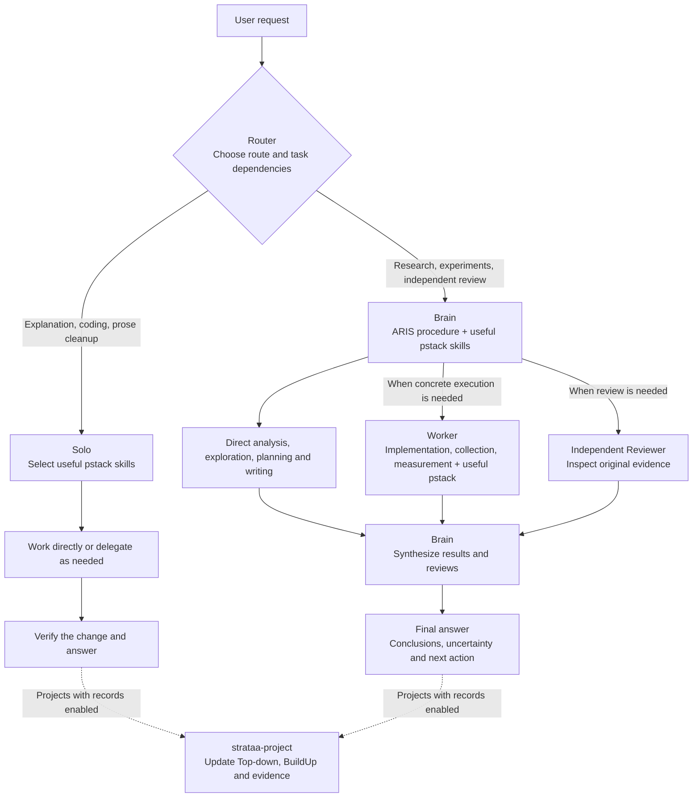

# Strataa: CLI research and engineering skills

[한국어](README.ko.md)

Strataa connects research procedures and engineering skills to OMP's native agents, tools, and terminal UI. Work stays in the CLI. Project records connect decisions to evidence, and the optional Dashboard stays off unless you start it.

- Repository: [myunhh/Strataa](https://github.com/myunhh/Strataa)
- Plugin ID: `omp-agent-strataa`. Command: `/strataa`.
- Research procedures: 87 upstream [ARIS](https://github.com/wanshuiyin/auto-claude-code-research-in-sleep) skills.
- Engineering support: 58 skills and 2 agents from [pstack](https://github.com/cursor/plugins/tree/bf0c7cd80abdbf7fe47b634978a7d1b4071f71a7/pstack) v0.15.42.

This is an independent OMP adaptation, not an official ARIS or OMP distribution. It preserves OMP's core, shared harness, default model choices, authentication, and recursion settings. Selecting or enabling Strataa models registers dedicated OMP approval roles.

## Install

Requires Node.js 22.13 or later and OMP 18.20.3 or later.

```sh
git clone https://github.com/myunhh/Strataa.git
cd Strataa
node install.mjs
```

After active OMP work finishes, run:

```text
/reload-plugins
/strataa skills
/strataa models
/strataa on
```

New sessions start with routing **off**. With routing on, make requests in normal language. You do not need to name a skill.

ADHD-friendly output is bundled and **on by default**, independently of routing. Use `/i-have-adhd off` (or `stop adhd mode` / `normal mode`) to disable it for the session, and `/i-have-adhd on` to re-enable it. Saved session choices and `alwaysOn: false` in the existing `i-have-adhd.json` configuration are respected. If the standalone plugin is installed, disable it with `omp plugin disable i-have-adhd@i-have-adhd` after installing Strataa to avoid duplicate commands and hooks.

The bundled skill and extension come from [i-have-adhd v0.3.0](https://github.com/ayghri/i-have-adhd/tree/839872f9d1cd634fed642b4589ce7226199cc15f), copyright Ayoub Ghriss, under [MIT](ADHD-LICENSE). Strataa changes the default flag to on and gives explicit `alwaysOn` configuration precedence; the rules and context compatibility helper are unchanged.

When migrating from Dialogue, first finish the new installation, then run `omp plugin uninstall omp-agent-dialogue` to remove the old registration. Do not reload an active work session. The installer preserves old immutable installations, research databases, and session history. There are no old command aliases. Environment variables use `STRATAA_*` and `OMP_STRATAA_FLOW_DIR`, while existing data paths and serialized session IDs remain compatible.

Installation copies the bundle to a fingerprinted directory under `~/.local/share/omp-agent-strataa/` and registers it with `omp plugin link`. Removing the clone does not remove the installed copy. Install separately on each host. Upstream updates are not automatic.

## Workflow



The branches are options, not mandatory stages. Brain can explore ideas, inspect evidence, plan, or write directly. When a review needs a newly produced artifact, the Reviewer waits for its producer. A Worker does not automatically trigger a Reviewer.

Prose cleanup does not force a review. Project records are updated only for actual changes; read-only requests do not modify records. The dotted links show record maintenance, not a mandatory step after every answer.

Router selects ordinary work or 1–4 ARIS skills and a dependency plan. Solo owns ordinary work. Brain is the main research session and owns assumptions, criteria, decomposition, claim decisions, and the final answer. Workers execute bounded packets. Reviewers inspect evidence independently in separate read-only sessions.

ARIS selects the research procedure. pstack helps Solo, Brain, and bounded ARIS Workers through the same [OMP adapter](pstack-omp.md). Only the relevant skills are loaded. Reviewer sessions do not receive the author's prose-polishing guidance.

### Use checks where they matter

Explore hypotheses and alternatives freely. A prose cleanup does not require a review panel, even in a research document. Changing wording alone stays ordinary Solo work unless you explicitly request review or another research procedure.

Use a targeted check when a change strengthens a claim, changes comparison criteria, incurs real cost, or takes an irreversible action. Check the affected evidence or permission, rather than adding a universal checklist to every edit.

An explicit review request and a selected ARIS workflow's review requirements still apply. Selective pstack does not waive those requirements, invent acceptance, or replace independent review with author self-review.

For example:

> Use ARIS research-review on this draft. Run one round, and distinguish accepted findings, rebuttals, and unresolved disagreements.

> Use ARIS experiment-plan to distinguish these hypotheses. Do not run experiments.

> Make this paragraph clearer without changing its claims.

Experiment execution, training, evaluation, seed/config batches, dependent queues, and overnight autonomous improvement route to ARIS. Follow-up requests retain the preceding context. Planning alone does not authorize execution. A filename containing "experiment" or "overnight" does not turn a code edit into an experiment run.

| Intent | Typical skill |
| --- | --- |
| Run a specified experiment or training job | `run-experiment` |
| Run multiple seeds/configurations or a dependent queue | `experiment-queue` |
| Observe a running job | `monitor-experiment` |
| Review, revise, and re-review existing research | `auto-review-loop` |
| Run research from idea exploration through experiments and review | `research-pipeline` |

Missing environment details do not silently switch research to ordinary work. The executor checks actual resources, permissions, and required inputs. User time, round, and cost limits remain binding. "Overnight" does not authorize endless loops or new paid rentals.

### Use PaperOrchestra for part of a paper

Keep the native writer unless you want [PaperOrchestra](https://github.com/google-research/paper-orchestra) to supply the related work or a full draft. With Strataa routing enabled, ask: “Import this PaperOrchestra draft and check its numbers and citations against these local sources. Do not write it again.” The bridge does not install the writer or authorize model calls.

From the Strataa checkout, run `npm run paper-orchestra -- --help`. `prepare` packs the approved writing inputs; `import` reads an existing run offline. `literature` and `draft` require a trusted external checkout, its environment and explicit permission to send the inputs to a provider. See the [commands and reviewer handoff](skills/strataa-paper-orchestra/SKILL.md). Importing a PDF does not verify its claims.

## Commands and models

| Command | Purpose |
| --- | --- |
| `/strataa on` | Enable routing after checking the installed bundle |
| `/strataa off` | Disable routing for future requests without stopping current work |
| `/strataa status` | Show mode, role models, and installation status |
| `/strataa skills` | List ARIS skills, source commit, installation path, and readiness |
| `/strataa pstack` | List pstack skills, version, and source integrity |
| `/strataa models` | Choose one model for all roles, individual roles, or recommended defaults |
| `/strataa models all <provider/model> [effort]` | Set all seven roles. Omitted effort means `auto` |
| `/strataa models default` | Restore the recommended configuration |
| `/strataa <role> [provider/model] [effort]` | Configure one role. Omit the model to open the picker |
| `/strataa flow` | Inspect the current dependency graph, instructions, and public results |
| `/strataa watch` | Observe this host's active OMP sessions in another terminal |
| `/strataa stop` | Stop routing or execution started by this extension |

Roles are `router`, `brain`, `worker`, `reviewer`, `solo`, `summary`, and `analysis`. Every role uses OMP's full available model list, not a fixed model family. The picker offers supported reasoning levels and saves nothing on cancellation.

| Role | Recommended model | Effort |
| --- | --- | --- |
| Router | `openai-codex/gpt-6.1-terra` | `xhigh` |
| Brain | `anthropic/claude-fable-5-2` | `high` |
| Worker | `anthropic/claude-opus-5-5` | `medium` |
| Reviewer and Solo | `openai-codex/gpt-6.2-astra` | `max` |
| Request summary | `openai-codex/gpt-6-luna` | `low` |
| Dashboard analysis | `openai-codex/gpt-6.2-astra` | `high` |

These defaults are configuration choices, not evidence of model superiority. `auto` uses the host/model automatic reasoning setting and also works for non-reasoning models. An unavailable model or unsupported explicit effort fails without fallback. Separate sessions on the same model are not cross-model validation.

Model settings are host-local at `${XDG_CONFIG_HOME:-~/.config}/strataa/models.json`. New sessions and the Dashboard share this file. A run freezes its selected models and efforts at startup. Wait for that run to finish before changing models. Invalid shared configuration is an error. Use `/strataa models default` to recover. Old session model settings are imported only when the shared file is absent.

Package updates preserve saved model choices. To adopt new defaults, run `/strataa models default` after the current run finishes.

Model selection, `/strataa on`, and the next routed request synchronize the selected models into OMP's global `modelRoles.strataa-<role>` entries. They also enable `task.perCallModel` and add the selected identities to an existing nonempty global allowlist. Existing `default`, `slow`, other roles, agent overrides, and credentials are unchanged. No separate approval command is needed. Project, config-overlay, and runtime restrictions remain effective and produce an explicit error rather than being overwritten. Turning Strataa off stops routing but retains these model registrations.

Router, Workers, Reviewers, and request summaries add model usage. Routing receives the request, images, and up to 24,000 characters of recent text. Check your providers' data-retention policies.

Direct OMP skill commands such as `/architect` or `/research-review` bypass Strataa input routing. Do not assume that a direct command receives the same automatic runtime enforcement as a routed request.

## Execution contract

- Before routing, the runtime checks the ARIS bundle's skill files, shared references, tools, templates, and executable modes. `/strataa on` and `/strataa pstack` also check the pinned pstack source. These checks do not validate external credentials or Python dependencies.
- The main session receives the selected full skill texts and OMP adaptation before the user request. OMP's native `task` runs bounded `aris-worker` packets and separate `aris-reviewer` sessions with configured role models.
- Workers receive goals, files, interfaces, user constraints, and completion checks. They do not delegate again, initiate reviews, or accept research claims. Brain requests reviews and writes the final synthesis.
- Reviewers use only `read`, `grep`, and `glob`. They read primary artifacts and a neutral brief. Later rounds receive the complete verified review output for the same Router stage, not histories from unrelated parallel stages.
- A valid review needs actual completion, matching host model metadata, and nonempty public output. Status notifications alone do not count. The runtime reads full published outputs, including long-output references, before releasing dependent work.
- Missing required review leaves the run `incomplete`. A failed invoked Worker or Reviewer makes the flow `failed`. Model mismatches, unreadable output, and empty reviews are failures, not automatic retries.
- Skill selection grants no extra permission for training, installation, deployment, publication, or paid services. Review completion is not scientific proof or forced agreement.

Runtime controls enforce routing, dependencies, model selection, and result tracking. Skill text supplies working instructions, not new tools or permissions. The pstack import does not provide Cursor Automation, Bugbot, cloud agents, or other Cursor-only services. Missing required helpers remain unavailable, not silently installed or reported as successful.

### Dependency waves

Wave 0 is Router, Wave 1 is the main session, and subsequent waves group stages by dependency depth. Independent inspections can share a wave. A check that consumes both inspections must declare both as predecessors.

Router supplies stage IDs, goals, concurrency limits of 1–4, and `dependsOn` lists. The runtime rejects missing, unknown, duplicate, self-referencing, or cyclic dependencies. No delegation means an empty plan. A plan has at most 12 stages.

The main session batches ready independent work in one native `task` call. Names use `<stage ID>__<task name>` within 32 characters. A prefix can be omitted only when one stage is ready. Omitted names receive collision-free reservations. Stage limits and a run-wide maximum of four concurrent tasks apply.

Consumers wait for all declared predecessors to succeed and deliver full public results, not for unrelated tasks. Starting a consumer closes its predecessors. Failed or cancelled stages do not retry automatically. Shared-file edits, shared-resource conflicts, and reviews of changing artifacts are dependencies, not parallel work. Child fan-out and alternate orchestration bypasses are not allowed.

## Project records in the CLI

Ask OMP:

> Use strataa-project to organize existing documents, code, and public results in `.strataa/project.json`. Connect Top-down concepts and BuildUp records to evidence.

> Use strataa-project to report the current conclusion, missing evidence, and one next action. Do not edit files.

For a local structural check without a model or server, run this from the installed Strataa directory:

```sh
node project-cli.mjs /absolute/project/path
node project-cli.mjs /absolute/project/path --json
```

The [strataa-project skill](skills/strataa-project/SKILL.md) interprets existing material and maintains stable record IDs. The CLI validates source-quote containment, IDs, hierarchy, and references. It does not edit files, infer records in an unrecorded directory, or reassess experimental results. Invalid records produce a nonzero exit.

The schema uses `schemaVersion: 1`, `project`, `sources`, `concepts`, and `buildUps`. Concepts connect field, problem, method, and technique. BuildUp records connect questions, hypotheses, decisions, experiments, and results to parents and evidence. See the [example](skills/strataa-project/example.json). `accepted` records a choice, not scientific validation. Do not invent past intentions, unrun experiments, or private reasoning.

When the project root already has `.strataa/project.json`, Solo and Brain receive the bundled record skill. The main session integrates updates and respects read-only requests. Projects without records are not forced to create them. Other hosts need the skill plus `project-cli.mjs` and `dashboard/projects.js`, not the skill directory alone.

## Inspect flows and sessions

`/strataa flow` shows tasks at the same dependency depth together, with actual predecessor links. Cards retain role, exact model, task ID, state, observed time, instructions, and public output. Planned tasks remain visible without counting as completed work.

Use Left/Right to change waves, Up/Down within a wave, Tab to move nodes, and Enter for details. Page Up/Down and Home/End navigate larger views. In details, Enter rereads the published output, Esc returns, and `q` closes the view. Closing a view does not stop execution.

Open another OMP terminal and run `/strataa watch`. Routing need not be on. The watcher shows graphs immediately, refreshes about every 0.5 seconds, and retains completed flows while the source OMP process lives. The next routed request replaces that session's flow. Use arrows or Tab to select a session, Enter for details, and `q` or Ctrl-C to close only the watcher.

On Linux, the watcher also discovers session files opened by the same user's live main OMP processes. Old sessions show saved records. Missing flow data stays unobserved rather than inferred. Other platforms use published snapshots. Existing work sessions need not reload or restart to be observed on Linux.

Each new routed request adds one configured summary-model call, whether a watcher is open or not. It receives the input text and image count, not image contents, surrounding conversation, or private thinking. Watcher refreshes and restored flows do not add calls. Summary failure leaves the main work running without retries.

Only public text is stored. Observed elapsed time is not proof of internal task runtime. Other processes' `agent://` outputs are not fetched. Snapshots use user-only permissions under `${XDG_STATE_HOME:-~/.local/state}/omp-agent-dialogue/flows/`. Set `OMP_STRATAA_FLOW_DIR` identically for producer and watcher to isolate snapshot discovery and disable Linux session-file discovery.

## Optional Dashboard and library

Only if you want the existing UI, run `npm run dashboard` from the Strataa installation and open http://127.0.0.1:4310. CLI records and validation do not need it. Strataa never starts the server automatically.

The server is loopback-only and rejects writes from other Origins or Hosts. It stores connection lists in `STRATAA_RESEARCH_DIR`, defaulting to `${XDG_DATA_HOME:-~/.local/share}/omp-agent-dialogue/research`. Project files are read-only. Disconnecting does not delete projects or papers.

Project reads reject symlinks, paths outside the project, and secret files. Limits are 2 MiB per manifest, 2 MiB per source, and 20 MiB across sources. Remove secrets embedded in ordinary documents yourself. Invalid updates report errors rather than presenting stale material as current.

The existing [/library](http://127.0.0.1:4310/library) retains PDF/text uploads, metadata fill, explicit full analysis, and export. Metadata fill uses `openai-codex/gpt-6-luna` with `low` effort and sends the first two PDF pages, at most 16,000 characters, to the provider. Check the opt-out and billing notice. Full analysis uses the shared `analysis` role and requires separate consent. Extraction uses local `pdftotext`, without OCR or automatic URL collection.

Environment variables are `STRATAA_DASHBOARD_PORT` with default 4310, `STRATAA_RESEARCH_DIR`, `OMP_BIN`, and `OMP_STRATAA_FLOW_DIR`. Run one server per repository.

## Sources, licenses, and limits

ARIS is pinned to commit `2927b40b2ea37774de53763338c5e8f91a7601e6`. Its 87 skills, shared references, `tools/`, and `templates/` preserve upstream material. Codex duplicates and legacy overlays are excluded. [aris-provenance.json](aris-provenance.json) lists sources, sizes, and modes. The upstream MIT license is [ARIS-LICENSE](ARIS-LICENSE), with additional skill-local licenses preserved.

pstack is pinned to commit `bf0c7cd80abdbf7fe47b634978a7d1b4071f71a7`, version 0.15.42. The unchanged 560-file source is under [vendor/pstack](vendor/pstack). [pstack-provenance.json](pstack-provenance.json) records source paths, sizes, modes, and SHA-256 hashes. Copyright 2026 Lauren Tan, [MIT license](vendor/pstack/LICENSE). Native wrappers and [pstack-omp.md](pstack-omp.md) are separate from upstream source.

The adapter preserves configured host models and permissions. It does not import upstream fallback models, global configuration changes, automatic PR/push/merge behavior, or helper installation. Search, LaTeX, GPU, and external API dependencies remain task-specific. `aris-fanout-leaf` is not installed. Use the upstream sequential alternative.

OMP sessions do not reproduce upstream Claude/Codex MCP servers, `reviewer_route.py` or `review_gate.py` backend approval, Copilot-native proof, or MCP thread reuse. OMP output is not recorded as upstream-certified acceptance.

Brain is the main session. Research delegates are `aris-worker` and `aris-reviewer`. pstack also supplies `poteto-agent` and `comment-sicko`. Old `rh-*` and `dialogue-*` role calls are blocked in ARIS runs. Other plugins' agent definitions remain untouched. To restore an older installation you still own, link its path with `omp plugin link`, then reload after current work finishes.

## Development checks

From the repository root:

```sh
node --test test/*.test.js
```

See [CHANGELOG.md](CHANGELOG.md) for release history and verification scope. A local test or UI check does not prove that every external skill integration works or validate research results. Development run records and private session/authentication data are not a portable verification guarantee.

The workflow diagram is also available as [raw Mermaid](figures/workflow-en.mmd) and a [preview](figures/workflow-en.md).
