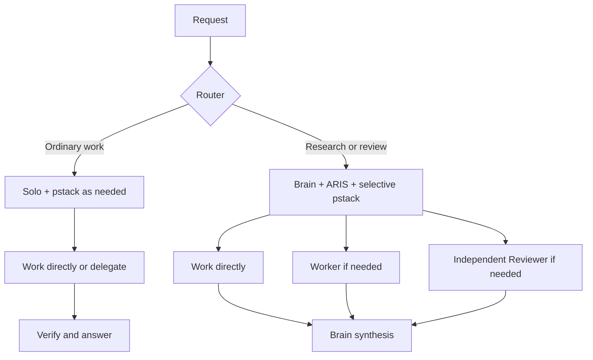

# Strataa workflow

Router selects ordinary work or research and review. Branches are optional, not mandatory stages. A review of a new artifact waits for its producer. A Worker does not automatically trigger a Reviewer.

[English README](../README.md) · [Raw Mermaid source](workflow-en.mmd)
