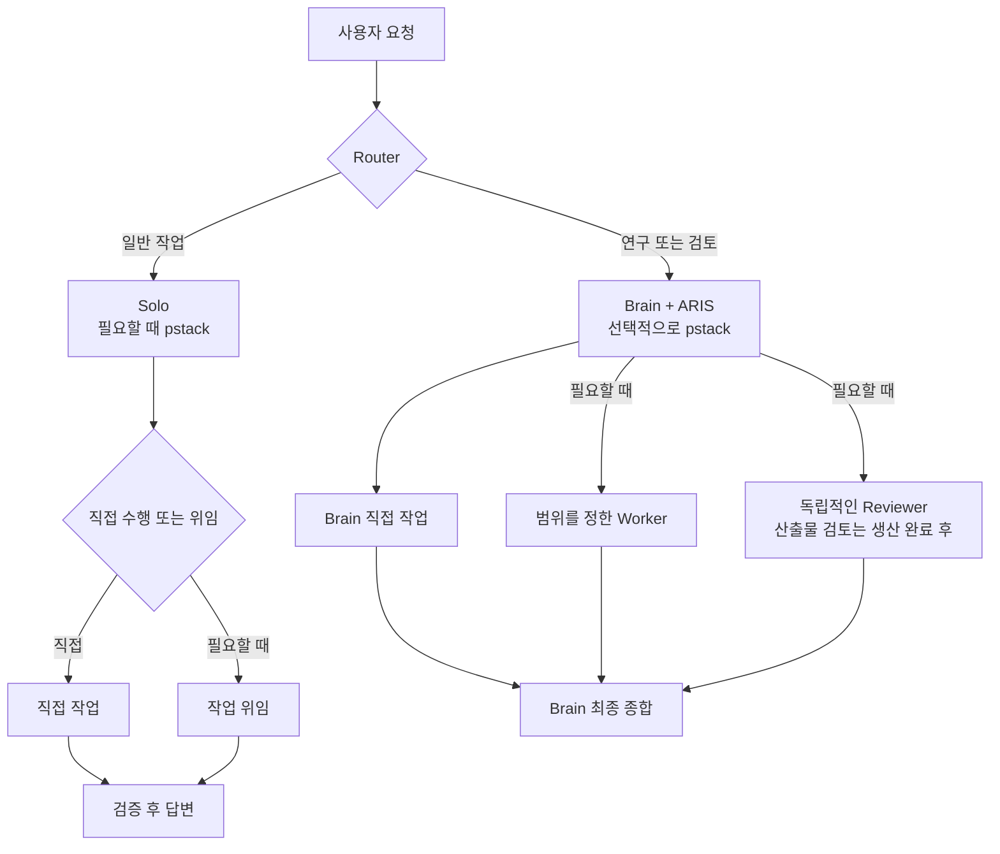

# Strataa 실행 구조

Router가 일반 작업과 연구·검토 작업을 구분합니다. 위임과 검토는 필요한 경우에만 실행합니다. 선택한 ARIS 스킬에 필수 검토가 있으면 그 계약을 유지합니다. 산출물을 검토하는 작업은 생산 작업이 끝나고 공개 결과를 받은 뒤 시작합니다.

[Mermaid 원본](workflow-ko.mmd) · [한국어 README](../README.ko.md)
