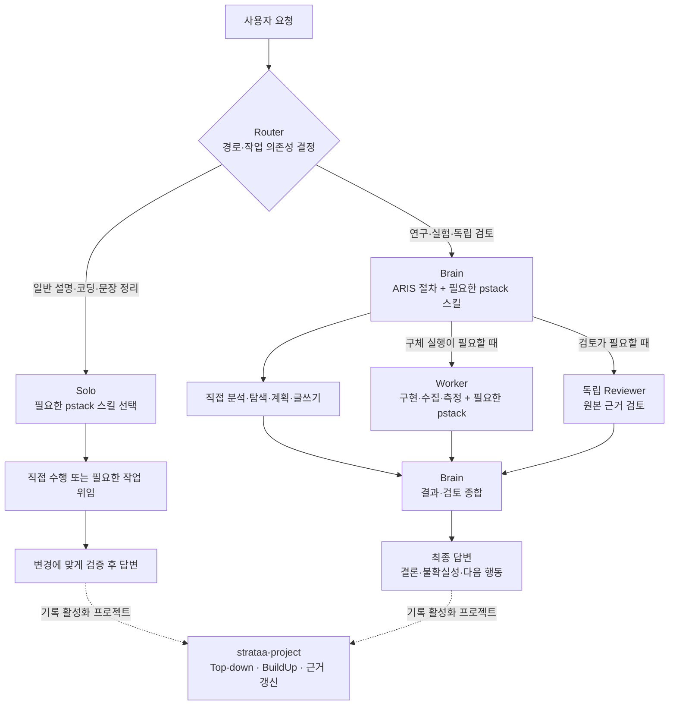

# Strataa 실행 구조

Router가 일반 작업과 연구·검토 작업을 구분합니다. 위임과 검토는 필요한 경우에만 실행하며 문장 정리에 리뷰를 강제하지 않습니다. 선택한 ARIS 스킬에 필수 검토가 있으면 그 계약을 유지합니다. 새 산출물의 검토는 생산 완료 후 진행합니다. 점선은 기록이 활성화된 프로젝트의 유지 작업이며 실제 변경이 있을 때만 갱신합니다. 읽기 전용 요청에서는 기록도 수정하지 않습니다.

[Mermaid 원본](workflow-ko.mmd) · [한국어 README](../README.ko.md)
